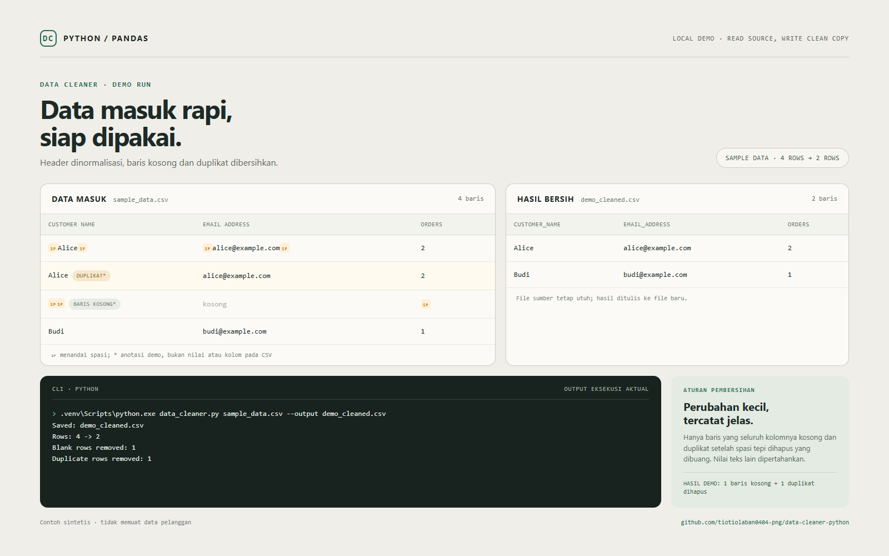

# Data Cleaner (Python + Pandas)

Script untuk membersihkan file CSV atau Excel `.xlsx` secara aman. File sumber tidak diubah; hasil disimpan ke file baru dengan akhiran `_cleaned`.



## Yang dibersihkan

- Nama kolom dirapikan menjadi `snake_case`.
- Spasi di awal/akhir nilai teks dihapus.
- Baris yang seluruh nilainya kosong dibuang.
- Baris yang menjadi duplikat setelah spasi tepi dihapus dibuang.
- File sumber tidak ditimpa. File hasil yang sudah ada juga tidak ditimpa.
- Untuk Excel, script membaca worksheet pertama saja.

## Menjalankan di Windows

Dari folder project, buka CMD atau PowerShell lalu jalankan:

```text
.venv\Scripts\python.exe -m pip install -r requirements.txt
.venv\Scripts\python.exe data_cleaner.py sample_data.csv
```

Contoh untuk file sendiri:

```text
.venv\Scripts\python.exe data_cleaner.py "C:\\Users\\pc\\Downloads\\data.csv"
```

Untuk menentukan lokasi output:

```text
.venv\Scripts\python.exe data_cleaner.py "C:\\Users\\pc\\Downloads\\data.xlsx" --output "C:\\Users\\pc\\Downloads\\data_bersih.xlsx"
```

## Tes

```text
.venv\Scripts\python.exe -m unittest -v
```

Contoh input `sample_data.csv` hanya berisi data sintetis untuk demonstrasi, bukan data pelanggan sungguhan.
